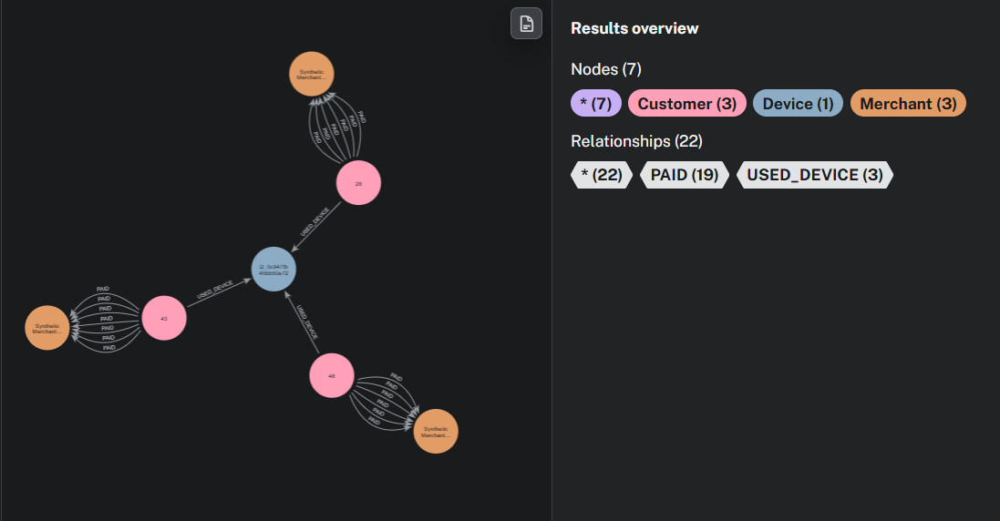
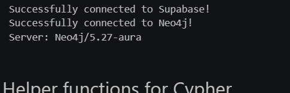
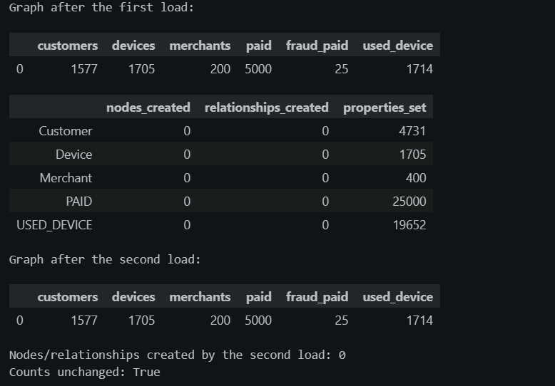
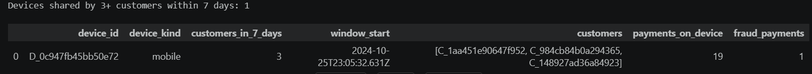
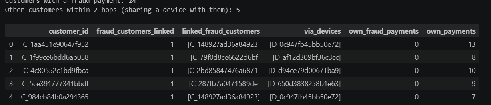
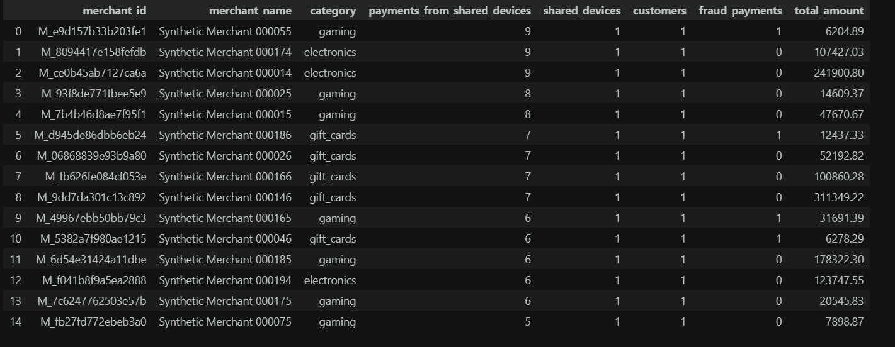

# SENTINEL Neo4j: Fraud Patterns in a Graph

Fraud often hides in **relationships**: one phone used by several customers, or a fraudster's device reused by others. These links are hard to see in tables. This project loads SENTINEL customers, devices and merchants from Supabase into **Neo4j Aura** and uses Cypher to find those patterns.

The notebook [`sentinel_neo4j.ipynb`](sentinel_neo4j.ipynb) covers the five tasks of the brief:

| # | Task | Notebook section |
|---|---|---|
| 1 | Run Neo4j (Docker or Aura) and connect from Python with `verify_connectivity()` | 1–3 |
| 2 | Create `Customer`, `Device`, `Merchant` nodes and `USED_DEVICE`, `PAID` relationships from at least 5,000 transactions | 4–8 |
| 3 | `MERGE` instead of `CREATE`, uniqueness constraints on the ids, and a second load that proves there are no duplicates | 6–9 |
| 4 | Cypher: devices shared by 3+ customers in 7 days, customers within 2 hops of a fraud payment, merchants most often paid from shared devices | 10 |
| 5 | Graph view of one suspicious cluster, with an explanation | 11 |

## Graph model

```
(:Customer {customer_id, age, home_city, region})
(:Device   {device_id, kind})
(:Merchant {merchant_id, name, category})

(:Customer)-[:USED_DEVICE {first_seen, last_seen, seen_at, uses}]->(:Device)
(:Customer)-[:PAID {transaction_id, amount, time, fraud_label, device_id, channel}]->(:Merchant)
```

- **`PAID`**: one relationship per payment. It carries the amount, time and fraud label, and the device the payment was made from.
- **`USED_DEVICE`**: one relationship per customer–device pair. It keeps every time the device was used (`seen_at`), so the 7-day sharing window can be checked exactly.

## Results

Run on Neo4j Aura (server Neo4j/5.27-aura) with 5,000 transactions from Supabase (30 Sep to 15 Nov 2024):

| Item | Value |
|---|---|
| Transactions loaded | 5,000 |
| Nodes | 1,577 Customer · 1,705 Device · 200 Merchant |
| Relationships | 5,000 PAID · 1,714 USED_DEVICE |
| Fraud-labelled payments | 25 (made by 24 customers) |
| Created by the second load | **0 nodes, 0 relationships**: counts unchanged, so the load is idempotent |
| Devices shared by 3+ customers within 7 days | 1 (`D_0c947fb45bb50e72`) |
| Customers within 2 hops of a fraud payment (via a shared device) | 5 |

**Merchants most paid from shared devices.** All of the top 15 are **gaming, electronics or gift-card** merchants: the categories where stolen funds are easiest to turn into goods. Four of them received fraud-labelled payments.

## The suspicious cluster



**What the graph shows.** One mobile **Device** (`D_0c947fb45bb50e72`, blue, centre) is linked by `USED_DEVICE` to **3 Customers** (pink). Within 7 days, starting 25 Oct 2024, all three used it. Together they made **19 payments** from this device (`PAID`), and each customer paid **one merchant (orange) again and again**, 6 to 7 times.

**Why it is suspicious.**
1. **Three accounts, one phone, one week.** Genuine customers pay from their own devices. One phone behind three accounts in a few days is the typical sign of a fraud ring, a mule handler, or stolen accounts operated from one place.
2. **Confirmed fraud on the device.** One of the 19 payments is labelled fraud, made by customer `C_148927ad36a84923`. The other two customers (`C_1aa451e90647f952` and `C_984cb84b0a294365`) have no fraud label, but query 10b flags both as **within 2 hops** of that fraud through this device.
3. **Repeated payments to the same merchant.** Many back-to-back payments to one merchant per account look like cashing out stolen value, or testing stolen credentials.

**Why tables miss it.** Each of the 19 transaction rows looks ordinary on its own: a normal customer, a valid merchant, a plausible amount. The pattern only appears when the rows are connected **through the shared device**.

**Action.** Send all three customers to manual review, add the device to the blocklist (SENTINEL's `hard_rules` support device blocklists), and put the 5 customers found by query 10b on a watch-list.

## Setup

1. **Clone the repository**

   ```bash
   git clone https://github.com/mrunalini-gudi/sentinel-neo4j.git
   cd sentinel-neo4j
   ```

2. **Start Neo4j.** Choose one option:

   - **Neo4j Aura (recommended, no install).** Create a free instance at https://console.neo4j.io. Save the password it shows: it appears only once. Your URI looks like `neo4j+s://<id>.databases.neo4j.io`.
   - **Docker** (needs WSL on Windows). Use a password of at least 8 characters, then open http://localhost:7474:

     ```bash
     docker run -d --name sentinel-neo4j -p 7474:7474 -p 7687:7687 -e NEO4J_AUTH=neo4j/<your-password> neo4j:5
     ```

3. **Create a virtual environment and install the packages**

   ```bash
   python -m venv sentinelenv
   sentinelenv\Scripts\activate
   pip install -r requirements.txt
   ```

4. **Add your credentials.** Copy `.env.example` to `.env` and fill in the Supabase and Neo4j values:

   ```bash
   copy .env.example .env
   ```

   `.env` is listed in `.gitignore`, so it is never committed.

5. **SENTINEL data in Supabase.** The notebook reads the `transactions`, `customers`, `devices`, `merchants` and `labels` tables loaded in Project Work 4 and 5 (`sql/create_table` then `python ingest.py all`).

## How to run

1. Open `sentinel_neo4j.ipynb` in VS Code or Jupyter and select the `sentinelenv` kernel.
2. Click **Run All**.
3. Optional: `SAMPLE_SIZE` (Section 4) sets how many transactions are loaded, at least 5,000. A larger sample (10,000–20,000) covers more time and finds more shared devices.
4. For the cluster view, Section 11 prints a Cypher query. Paste it into Neo4j Browser (http://localhost:7474, or the **Query** tab in Aura).

**If `verify_connectivity()` fails**, check that the variable is named `NEO4J_URI`, that the Aura instance is not paused, and that the URI starts with `neo4j+s://` for Aura or `bolt://` for Docker. Restart the kernel after editing `.env`.

## Cypher queries

### Devices shared by 3+ customers within 7 days
```cypher
MATCH (d:Device)
WHERE COUNT { (d)<-[:USED_DEVICE]-(:Customer) } >= 3
MATCH (c:Customer)-[u:USED_DEVICE]->(d)
UNWIND u.seen_at AS t
WITH d, c.customer_id AS customer, t ORDER BY t
WITH d, collect({customer: customer, t: t}) AS uses
UNWIND uses AS anchor
WITH d, anchor.t AS window_start,
     [x IN uses WHERE x.t >= anchor.t AND x.t < anchor.t + duration({days: 7}) | x.customer] AS in_window
WITH d, window_start, reduce(s = [], x IN in_window | CASE WHEN x IN s THEN s ELSE s + x END) AS customers
WHERE size(customers) >= 3
RETURN d.device_id, max(size(customers)) AS customers_in_7_days
ORDER BY customers_in_7_days DESC
```

### Customers within 2 hops of a fraud-labelled payment
```cypher
MATCH (f:Customer)-[:PAID {fraud_label: 1}]->(:Merchant)
WITH DISTINCT f
MATCH (f)-[:USED_DEVICE]->(d:Device)<-[:USED_DEVICE]-(other:Customer)
WHERE other <> f
RETURN other.customer_id, collect(DISTINCT f.customer_id) AS linked_fraud_customers,
       collect(DISTINCT d.device_id) AS via_devices
```
This query hops through **devices** only. A merchant is paid by hundreds of customers, so hopping through merchants would flag almost everyone.

### Merchants most often paid from shared devices
```cypher
MATCH (d:Device)
WHERE COUNT { (d)<-[:USED_DEVICE]-(:Customer) } >= 2
MATCH (d)<-[:USED_DEVICE]-(c:Customer)-[p:PAID]->(m:Merchant)
WHERE p.device_id = d.device_id
RETURN m.merchant_id, m.category, count(p) AS payments_from_shared_devices,
       count(DISTINCT d) AS shared_devices, sum(p.fraud_label) AS fraud_payments
ORDER BY payments_from_shared_devices DESC
LIMIT 15
```

## Screenshots

### Connection to Supabase and Neo4j Aura


### Graph counts and the idempotent second load


### Devices shared by 3+ customers in 7 days


### Customers within 2 hops of fraud


### Merchants most paid from shared devices


### Suspicious cluster (Neo4j Browser)


## Security

- Keys live only in `.env`, which Git ignores. `.env.example` holds placeholders only.
- The Neo4j credentials `.txt` file that Aura offers to download is also ignored. Never commit it.
- If a key is ever pushed by mistake, rotate it straight away in Supabase or Aura: deleting the file afterwards does not remove it from Git history.
